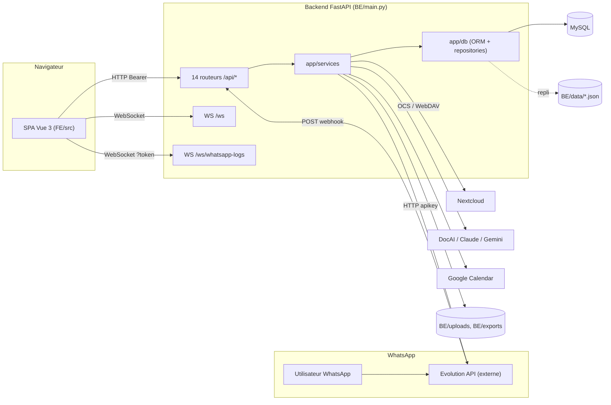

# 03 — Cartographie du code

> Phase 1 — lecture seule. **BE** = `smartcompta-v4/smartcompta-v6-backend/`, **FE** = `smartcompta-v4/smartcompta-v6-frontend/`.
> « Prouvé » = lu dans le code. Aucun code n'a été exécuté (voir §8).

## 1. Architecture générale (prouvée)

## 2. Points d'entrée

| Composant | Fichier | Détails prouvés |
|---|---|---|
| API | `BE/main.py` | `FastAPI(lifespan=...)` ; middlewares CORS, `LoggerMiddleware`, `RequestContextMiddleware`, `PayrollStreamDebugMiddleware`, batch télémétrie IA (l.306-318). Import à effet de bord `app.core.sidecars.ai_spy` (monkey-patch SDK IA, l.31). |
| Démarrage (`lifespan`) | `BE/main.py` l.122-232 | Diagnostic config ; `init_db()` (échec → avertissement « fallback JSON ») ; table télémétrie ; seed des utilisateurs par défaut ; `startup_cleanup()` supprime exports > 7 jours et uploads non référencés. |
| Exécution | `Dockerfile` racine, `BE/Dockerfile` | `uvicorn main:app --workers 2`. |
| SPA | `FE/src/main.ts`, `FE/src/App.vue`, `FE/src/layouts/MainLayout.vue` | Servie par FastAPI (`/assets`, catch-all `/{full_path}`) ou par nginx (`FE/Dockerfile`). |
| Fichiers statiques | `BE/main.py` l.513-517 | `/assets` (build) et **`/uploads` monté publiquement** (`StaticFiles(settings.UPLOAD_DIR)`). |

## 3. Routes HTTP (enregistrement `BE/main.py` l.338-351)

| Routeur (fichier) | Préfixe | Auth au niveau routeur | Rôle |
|---|---|---|---|
| `app/api/routes.py` `router` | `/api` | **Oui** `Depends(get_current_user)` | Upload / CRUD / validation / export des documents extraits, `/api/exports/{filename}`, nettoyage, diagnostic DocAI. |
| `app/api/routes.py` `public_router` | `/api` | Non (volontaire, commentaire l.68) | `GET /api/invoices/{id}/preview`. |
| `app/api/auth_routes.py` | `/api/auth` | Par endpoint | Login, me, logout, refresh, change-password, gestion utilisateurs (admin). |
| `app/api/nextcloud_routes.py` | `/api/nextcloud` | Par endpoint (partiel) | **CRUD des clients utilisé par le frontend**, fichiers Nextcloud, import, nettoyage. |
| `app/api/settings_routes.py` | `/api/settings` | Partiel | `/config`, `/db/test`, `/db/init`, `/nextcloud/test` sans auth ; `/integrations`, `/whatsapp/test` admin. |
| `app/api/async_routes.py` | `/api` | Non | `/upload-async`, `/bank-statements/upload-async`, `/jobs`. |
| `app/api/bank_statement_routes.py` | `/api/bank-statements` | Non | Relevés bancaires. |
| `app/api/extract_routes.py` | `/api/extract` | Non | Variante d'upload / CRUD / export. |
| `app/api/client_routes.py` | `/api/clients` | Non | CRUD client **incompatible** avec `client_service` (01 §3 C3) ; factures par client ; exports. Non appelé par le frontend. |
| `app/api/demarches/router.py` | `/api/demarches` | **Non (aucune référence d'auth dans le fichier)** | Pôles, services (catalogue), dossiers, débours, paiements, config facture cabinet, génération facture / reçu / avoir PDF, `setup-db`, `patch-db-tva`. |
| `app/api/compliance_routes.py` | `/api/compliance` | Partiel (2 endpoints) | Échéances, circulaires IA, calendrier, exports, flux ICS. |
| `app/api/endpoints/payroll.py` | `/api/payroll` | **Oui** (routeur) | Paie. |
| `app/api/whatsapp_routes.py` | `/api/whatsapp` | Par endpoint | `/health`, `/connect-qr` (admin) ; **`/webhook` sans auth**. |
| `app/api/finops_routes.py` | `/api/admin` | Par endpoint | Statistiques d'usage IA. |
| `BE/main.py` | — | — | `/health`, `/api/health`, `/`, WS `/ws` (sans auth), WS `/ws/whatsapp-logs` (admin via `?token=`). |

## 4. Couches backend

| Dossier | Rôle constaté | Exemples |
|---|---|---|
| `app/api/` | Contrôleurs FastAPI. Logique métier souvent **inline** dans les routes (ex. calcul et génération de facture dans `demarches/router.py` l.843-948). | — |
| `app/application/use_cases/` | Cas d'utilisation (style hexagonal) **uniquement pour l'upload** : `UploadInvoicesUseCase`, `UploadBankStatementsUseCase`, injectés via `app/api/dependencies.py`. | — |
| `app/application/ports/`, `app/domain/repositories/`, `app/infrastructure/` | Ports d'extraction et interface `IInvoiceRepository` + implémentation JSON. | — |
| `app/services/` | Services métier et intégrations (singletons de module : `evolution_api_service`, `whatsapp_state_machine_service`, `nextcloud_service`, `client_service`, `job_manager`…). | 54 fichiers `.py` |
| `app/db/` | ORM SQLAlchemy (`models.py`, `demarches_models.py`), moteur (`engine.py`), repositories MySQL (`repositories.py`, `whatsapp_repository.py`), sélection MySQL/JSON (`service_factory.py`), synchronisations de schéma (`*_schema_sync.py`). | — |
| `app/models/` | Schémas Pydantic (`schemas.py`, `demarches_schemas.py`, `compliance_schemas.py`). | — |
| `app/core/` | Config (`config.py`, pydantic-settings, `.env`), journalisation, erreurs, télémétrie IA, hub WebSocket WhatsApp. | — |
| `app/payroll_module/` | Moteur de paie autonome. | — |
| `app/referentiels/`, `app/utils/pcm*` | Référentiels CGI / PCM / banques marocaines. | — |

### Accès base de données — trois styles coexistent (prouvé)

1. **Dépendance FastAPI** `Depends(get_session)` (`app/db/engine.py` l.64-71) — Démarches, paie.
2. **Fabrique** `get_storage_service()` / `get_client_service()` (`app/db/service_factory.py`) — renvoie un repository MySQL ou le service JSON selon `is_db_available()` (calculé une fois).
3. **Session ouverte manuellement** `get_session_factory()()` + `close()` — WhatsApp (`whatsapp_routes.py`, `whatsapp_state_machine_service.py`). **Pas de repli JSON** pour WhatsApp.

Méthodes « async » des repositories : elles sont déclarées `async` mais exécutent des appels SQLAlchemy **synchrones** (ex. `WhatsAppRepository.get_session_by_phone`), donc bloquantes pour la boucle d'événements.

## 5. Frontend

| Élément | Fichier(s) | Constat |
|---|---|---|
| Routage | `FE/src/router/index.ts`, `admin_routes.ts` | Garde globale `requiresAuth` / `requiresAdmin`. |
| Menu | `FE/src/composables/useMainSidebarNav.ts` | 9 entrées (Factures, Assistant, Paie, Conformité, Démarches, Fichiers Clients, Dépôts Clients, Documentation, Paramètres). Point d'insertion naturel d'un futur menu « Commercial ». |
| HTTP | `FE/src/shared/services/http.ts` | Axios, base `appEnv.apiBase`, Bearer depuis `localStorage('smartcompta_token')`, redirection `/login` sur 401. |
| Environnements | `FE/src/config/env.ts`, `FE/.env.*`, `FE/vite.config.ts` | `/api` en dev, `/smartcompta/api` en prod. |
| Modules API | `FE/src/modules/{auth,clients,demarches,extraction,invoices,settings}/api.ts` | Convention « module = api.ts + types.ts ». |
| Stores Pinia | `FE/src/stores/*` | `authStore`, `invoiceStore`, `demarches`, `complianceStore`, `filesRealtime` (WebSocket WhatsApp)… |
| Vues clés pour la mission | `ClientManagementView.vue`, `components/clients/ClientCreateModal.vue`, `ClientSearchSelect.vue` (réutilisable pour sélectionner un client), `views/demarches/Kanban.vue` (génération facture / reçu / avoir), `views/SettingsView.vue` (config WhatsApp) | — |
| Style | Tailwind ; tokens `brand.*`, tailles tactiles `min-h-touch` (CHANGELOG 6.5.4) ; store `display` pour mobile / tablette / desktop. | Le nouveau module devra suivre ces conventions. |
| Tests | Aucun | — |

## 6. Conventions observées

- Nommage backend en **français et anglais mélangés** (`generer_facture`, `DemarcheFacture`, `list_clients`, `upload_media_with_retry`).
- Identifiants : UUID `String(36)` (sauf `payroll_archives.id` entier).
- Montants : `Numeric(12,2)` / `Numeric(14,2)` et `Decimal` quantize `0.01` (`app/utils/money.py` : `ROUND_HALF_UP`). Le module Démarches utilise `quantize(Decimal("0.01"))` sans mode explicite (arrondi par défaut du contexte `Decimal`, `ROUND_HALF_EVEN`).
- Statuts : `SAEnum` SQL ou chaînes libres (`whatsapp_sessions.state`).
- Migrations : **pas d'Alembic en usage** (dépendance déclarée mais aucun répertoire `alembic/`) ; `Base.metadata.create_all` + `ALTER TABLE … IF NOT EXISTS` au démarrage + scripts SQL manuels numérotés.
- Journalisation : `logging` standard + `sc_log` catégorisé ; préfixes `chatbot_`, `whatsapp_`.
- Code de debug résiduel : écritures vers des chemins Windows codés en dur (`BE/app/db/models.py` l.100-110, `BE/app/models/schemas.py` l.186, 243) ; fichiers `.log` versionnés dans l'archive.

## 7. Scripts et outillage

| Fichier | Rôle |
|---|---|
| `BE/scripts/migrate_*.py`, `seed_compliance_data.py`, `reconcile_invoice_integrity.py` | Migrations / seed / réconciliation ponctuels. |
| `BE/scripts/debug_whatsapp_workflow.sh` | `tail -F` filtré des logs chatbot. |
| `BE/audit_smartcompta_flow.py`, `FE/audit_frontend_calls.ts`, `FE/check_ui_readiness.ts` | Scripts d'audit internes (non exécutés). |

## 8. Tests existants

| Fichier | Portée |
|---|---|
| `BE/tests/test_whatsapp_webhook.py` | 1 test : `POST /api/whatsapp/webhook` → `{"status":"processing"}` (tâche de fond neutralisée). |
| `BE/tests/test_whatsapp_state_machine.py` | 3 tests : salutation inconnue, « hello » → AWAITING_ID, normalisation RC/CIN (repository simulé). |
| `BE/tests/test_whatsapp_webhook_parse.py` | 7 tests de normalisation Evolution v2 + dédoublonnage. |
| `BE/tests/test_evolution_api_service.py` | 3 tests `send_text_message`. |
| `BE/tests/test_storage_whatsapp_nextcloud.py` | 3 tests du passe-plat Nextcloud. |
| `BE/tests/test_client_validation.py` | 1 test 422 `MORALE` sans RC. |
| `BE/tests/test_task10_nextcloud_password.py` | 5 tests : lien de reset, mot de passe Nextcloud (401/403/succès). |
| `BE/tests/test_compliance_ics.py`, `test_demarches_sync.py` | Conformité, synchronisation Démarches. |
| `BE/tests/payroll/*` (4), `BE/tests/upgrade_validation/*` (4 + conftest) | Paie, smoke tests d'import / santé / BDD. |

**Aucun test** ne couvre la génération de factures Démarches, `InvoicePDFGenerator`, ni les états `MENU` → `AWAITING_MEDIA` → upload.

**Exécution :** non réalisée. L'environnement de la session ne dispose pas des dépendances (`fastapi` absent, Python 3.13 au lieu de 3.12) et la mission interdit l'installation sans autorisation. Les fichiers `.pyc` `*-pytest-9.0.3.pyc` montrent que les tests ont été exécutés au moins une fois ailleurs ; **les résultats ne sont pas connus**.
