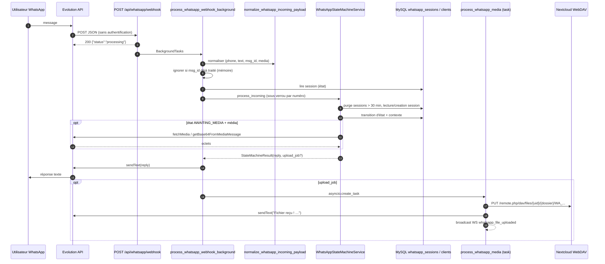
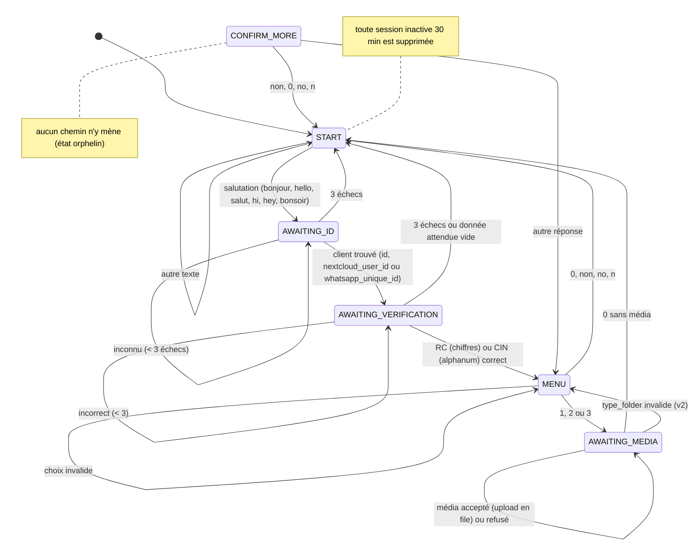

# 04 — Flux WhatsApp

> Phase 1 — lecture seule. **BE** = `smartcompta-v4/smartcompta-v6-backend/`, **FE** = `smartcompta-v4/smartcompta-v6-frontend/`.
> Classification utilisée pour chaque comportement :
> **[PROUVÉ]** lu dans le code · **[DOCUMENTÉ]** seulement dans un CHANGELOG · **[SUPPOSÉ]** déduction non vérifiable dans les sources · **[ABSENT]** inexistant ou incomplet.

## 1. Résumé

Le chatbot existant est un **assistant de dépôt de documents** : un client du cabinet s'identifie (ID unique puis RC ou CIN), choisit un dossier (Achats / Relevés / Ventes) et envoie une photo ou un PDF, qui est déposé dans son espace Nextcloud. Il n'appelle **aucun service métier** autre que le stockage, et ne sait **envoyer que du texte**.

Il est **réutilisable** comme socle (réception, normalisation, identification, persistance d'état, verrou par numéro, envoi texte, console de debug) ; il ne couvre ni la saisie de données structurées, ni le récapitulatif / confirmation, ni l'envoi de PDF.

## 2. Composants

### 2.1 `BE/app/api/whatsapp_routes.py`

| # | Point | Constat |
|---|---|---|
| 1 | Rôle | Routeur `/api/whatsapp` ; orchestration post-webhook ; tâche d'upload. |
| 2 | Fonctions / classes | `receive_whatsapp_webhook` (l.437), `process_whatsapp_webhook_background` (l.294), `process_whatsapp_media` (l.118), `_clear_whatsapp_session_context` (l.87), `whatsapp_evolution_health` (l.392), `whatsapp_connect_qr` (l.414), verrous `_get_phone_fsm_lock` (l.29), dédoublonnage `_whatsapp_delivery_was_processed` / `_mark_processed` (l.51-72), modèles `WhatsAppHealthResponse`, `WhatsAppConnectQrResponse`. |
| 3 | Imports | `require_admin`, `emit_whatsapp_live_log`, `get_session_factory`, `WhatsAppRepository`, `evolution_api_service`, `normalize_whatsapp_incoming_payload`, `whatsapp_media_service`, `whatsapp_state_machine_service` ; imports tardifs `from main import ws_manager`, `app.services.storage.upload_whatsapp_pass_through_to_nextcloud`. |
| 4 | Appelé par | `BE/main.py` l.44, 350 (`include_router`). Le webhook est appelé par l'Evolution API [SUPPOSÉ : URL configurée côté Evolution, non présente dans les sources]. |
| 5 | Appelle | Machine à états, Evolution API (texte), Nextcloud (via storage ou media service), WebSocket `/ws` et hub `/ws/whatsapp-logs`. |
| 6 | Entrées / sorties | Webhook : `dict[str, Any]` libre (aucun schéma) → `{"status": "processing"}`. Health / QR : réponses Pydantic. |
| 7 | Effets de bord | Écriture `whatsapp_sessions` ; appels HTTP sortants ; écriture Nextcloud ; diffusion WebSocket ; état mémoire de module (`_phone_fsm_locks`, `_WA_WEBHOOK_MSG_DEDUP`). |
| 8 | Sécurité | `/health`, `/connect-qr` : `require_admin`. **`/webhook` : aucune authentification, aucune vérification de signature ni de secret, aucun contrôle d'origine.** |
| 9 | Tests | `test_whatsapp_webhook.py` (1), `test_whatsapp_webhook_parse.py` (dédoublonnage). |
| 10 | Limites / défauts | (a) État mémoire non partagé entre les 2 workers uvicorn : dédoublonnage et verrous inefficaces si deux livraisons tombent sur des workers différents [SUPPOSÉ quant à l'occurrence, PROUVÉ quant à la conception]. (b) `asyncio.create_task` sans référence conservée ni reprise après redémarrage. (c) Les envois Evolution utilisent `requests` **synchrone** dans des coroutines → blocage de la boucle d'événements. (d) `_clear_whatsapp_session_context` non appelé dans la branche passe-plat. |

### 2.2 `BE/app/services/whatsapp_webhook_parse.py`

| # | Point | Constat |
|---|---|---|
| 1 | Rôle | Normaliser le corps Evolution v2 / Baileys ou legacy plat en `{phone_number, text, whatsapp_message_id, media, media_type}`. |
| 2 | Fonctions | `digits_from_whatsapp_jid`, `text_from_baileys_message`, `_extract_evolution_v2_media`, `_resolve_data_block`, `normalize_whatsapp_incoming_payload`. |
| 6 | Entrées / sorties | `data` objet ou liste (premier élément), ou message plat avec `key`. Texte : `conversation`, `extendedTextMessage.text`, légendes image/vidéo/document. Médias : `documentMessage`, `imageMessage` uniquement. |
| 8 | Sécurité | Aucune validation de type d'événement (`event`), ni du champ `key.fromMe`, ni du type de JID (individuel vs groupe). |
| 9 | Tests | 7 tests. |
| 10 | Limites | Les messages émis par le bot lui-même ou provenant d'un groupe ne sont pas filtrés [PROUVÉ : absence de filtre ; SUPPOSÉ : qu'Evolution livre ces événements au webhook]. |

### 2.3 `BE/app/services/whatsapp_state_machine_service.py`

| # | Point | Constat |
|---|---|---|
| 1 | Rôle | Machine à états conversationnelle persistée, une session par numéro. |
| 2 | Classe / fonctions | `StateMachineResult` (reply, state, success, enqueue_upload, upload_job) ; `WhatsAppStateMachineService.process_incoming`, `send_reply`, `_advance_to_id`, `_handle_id`, `_handle_verification`, `_handle_menu`, `_handle_media`, `_handle_media_evolution_v2`, `_handle_confirm_more`, `_terminate_session`, `_set_state`, `_is_expired`, `_is_physique`, `_is_greeting`, `_norm_rc`, `_norm_cin`. Constantes : TTL 30 min, 3 échecs, extensions `.pdf .jpg .jpeg .png .webp`, 15 Mo, `MENU_TEXT`, `MENU_MAP`. |
| 3 | Imports | `get_session_factory`, `WhatsAppRepository`, `evolution_api_service`, `nextcloud_folder_for_whatsapp_menu_type`, `whatsapp_media_service` (importé, non utilisé directement). |
| 4 | Appelé par | `process_whatsapp_webhook_background`. |
| 5 | Appelle | `WhatsAppRepository` (sessions, config, recherche client), `evolution_api_service.send_text_message`, `evolution_api_service.fetch_media` (via `asyncio.to_thread`). |
| 6 | Entrées / sorties | Payload normalisé → `StateMachineResult`. |
| 7 | Effets de bord | `cleanup_expired_sessions` **supprime** à chaque message toutes les sessions inactives depuis 30 min ; upsert de session ; téléchargement du média en mémoire (base64). |
| 8 | Sécurité | Authentification à deux facteurs faibles (ID unique **ou** `clients.id` **ou** `nextcloud_user_id`, puis RC/CIN) ; 3 essais puis retour à START, sans blocage durable ni limitation de débit. Stocke `nextcloud_password` du client **en clair** dans `whatsapp_sessions.context_json`. |
| 9 | Tests | 3 tests (START, AWAITING_ID, normalisation). Aucun pour MENU, AWAITING_MEDIA, expiration, échecs répétés. |
| 10 | Défauts | Voir §6. |

### 2.4 `BE/app/services/evolution_api_service.py`

| # | Point | Constat |
|---|---|---|
| 1 | Rôle | Client HTTP Evolution API. |
| 2 | Méthodes | `send_text_message` (POST `/message/sendText/{instance}`, corps `number`, `text`, `linkPreview`), `fetch_media` (POST `/instance/fetchMedia/{instance}` puis repli `/chat/getBase64FromMediaMessage/{instance}`), `probe_instance` (GET `connectionState` / `manager/health` / `/`), `fetch_instance_connect_qr` (GET `/instance/connect/{instance}`). |
| 3 | Imports | `requests` (**non déclaré dans `BE/requirements.txt`**). |
| 6 | Sorties | `bool` ou tuples `(ok, message, données)`. Jamais d'exception propagée. |
| 8 | Sécurité | En-tête `apikey`. Journalise jusqu'à 1 000 caractères de la réponse en cas d'erreur. |
| 9 | Tests | 3 tests (`send_text_message`). |
| 10 | Limites | **[ABSENT] aucune méthode d'envoi de document / média.** Le schéma de l'endpoint d'envoi de média n'est pas documenté dans les sources (`NON DOCUMENTÉ — À CONFIRMER`). |

### 2.5 `BE/app/db/whatsapp_repository.py`

| # | Point | Constat |
|---|---|---|
| 2 | Méthodes | `get_session_by_phone`, `cleanup_expired_sessions`, `upsert_session` (commit à chaque appel ; **réinitialise** `last_*`, `client_id`, `selected_menu`, `is_active` s'ils ne sont pas passés), `get_or_create_config` (première ligne de `whatsapp_config`), `update_config`, `find_client_by_unique_id`. |
| 10 | Limites | Méthodes `async` exécutant du SQL synchrone. `upsert_session` : les appels qui omettent `selected_menu` l'effacent (ex. `_handle_media` après `_handle_menu`). |

### 2.6 Autres composants

| Fichier | Rôle | Remarques |
|---|---|---|
| `BE/app/services/whatsapp_media_service.py` | Upload WebDAV avec création de dossiers (`MKCOL` en chaîne) et 3 essais (`time.sleep` bloquant). | Utilisé seulement pour le chemin legacy base64. |
| `BE/app/services/storage.py` l.22-31, 429+ | `WHATSAPP_MENU_TO_NEXTCLOUD_FOLDER` ; `upload_whatsapp_pass_through_to_nextcloud` (PUT direct avec les identifiants **du client**, nom `WA_{date}_{heure}_{fichier}`). | Chemin utilisé pour les médias Evolution v2. |
| `BE/app/core/whatsapp_live_log_hub.py` | Diffusion des lignes de log vers `/ws/whatsapp-logs`. | Réutilisable pour le debug du nouveau flux. |
| `BE/main.py` l.433-460 | WS `/ws/whatsapp-logs?token=` (admin). | Jeton en query string. |
| `BE/main.py` l.409-430 + `ws_manager` | WS `/ws` **sans authentification** ; diffuse `whatsapp_file_uploaded` (avec numéro de téléphone) et `whatsapp_session`. | Fuite de données à tout client WebSocket connecté [PROUVÉ par absence de contrôle]. |
| `BE/app/api/settings_routes.py` l.234-310 | Lecture / écriture de `whatsapp_config` (clé masquée en lecture), test d'envoi (admin). | — |
| `FE/src/views/SettingsView.vue`, `FE/src/modules/settings/api.ts` | UI de configuration, santé, QR, console live. | — |
| `FE/src/stores/filesRealtime.ts`, `FE/src/components/navigation/MobileHeader.vue` | Réception des événements WebSocket WhatsApp. | — |
| `BE/app/db/models.py` l.248-277 ; `BE/sql_migrations/003_*.sql` | Tables `whatsapp_sessions`, `whatsapp_config`. | Voir 05. |

### 2.7 Fichiers demandés en point de départ

| Fichier | Lien avec WhatsApp |
|---|---|
| `whatsapp_routes.py` | Central (ci-dessus). |
| `client_routes.py` | **Aucun.** CRUD `/api/clients` non relié au chatbot et incohérent avec `client_service` (01 §3 C3). |
| `routes.py` | **Aucun** lien direct ; fournit `/api/exports/{filename}` (téléchargement authentifié des PDF). |
| `async_routes.py` | **Aucun** lien direct ; modèle de tâches de fond `BackgroundTasks` + `job_manager` en mémoire pour les uploads web. |
| Cas d'utilisation (`app/application/use_cases/`) | **Non utilisés** par le chatbot (le dépôt WhatsApp ne déclenche aucune extraction DocAI — confirmé par le log « passe-plat Nextcloud, sans DocAI », `whatsapp_routes.py` l.343-346). |

## 3. Flux d'exécution reconstitué

### 3.1 Séquence (chemin Evolution v2, nominal)

### 3.2 Machine à états

### 3.3 Statut de chaque étape du flux cible

Flux cible de la mission : *réception → identification de l'expéditeur → validation de la requête → interprétation de la commande → état conversationnel → appel du service métier → préparation du document → envoi de la réponse*.

| Étape | Statut | Preuve / remarque |
|---|---|---|
| Réception du webhook | **[PROUVÉ]** | `whatsapp_routes.py` l.437-448. |
| Identification de l'expéditeur | **[PROUVÉ]** partiel | Numéro extrait de `key.remoteJid` (`whatsapp_webhook_parse.py`). Identité métier par ID + RC/CIN. Aucune liaison entre le numéro et le client : **n'importe quel numéro** connaissant ID + RC/CIN est accepté. |
| Validation de la requête | **[ABSENT]** | Aucun secret / signature / liste d'IP ; aucun schéma Pydantic ; aucun filtre `fromMe` ni `event`. |
| Interprétation de la commande | **[PROUVÉ]** minimal | Comparaisons de chaînes exactes (salutations, `0`-`3`, `non`). Pas de NLP, pas de LLM. |
| Gestion de l'état conversationnel | **[PROUVÉ]** | Table `whatsapp_sessions`, TTL 30 min, verrou `asyncio.Lock` par numéro (mono-processus). |
| Appel du service métier | **[ABSENT]** pour le commercial ; **[PROUVÉ]** seulement pour le stockage Nextcloud. | — |
| Préparation du document | **[ABSENT]** | Aucune génération côté chatbot. |
| Envoi de la réponse | **[PROUVÉ]** texte uniquement ; **[ABSENT]** document. | `send_text_message`. |
| Persistance des échanges | **[PROUVÉ]** partielle | Seuls le dernier message utilisateur et la dernière réponse sont conservés (`last_user_message`, `last_bot_message`) ; pas d'historique. |
| Tâches asynchrones | **[PROUVÉ]** | `BackgroundTasks` + `asyncio.create_task` ; pas de file persistante. |
| Gestion des erreurs | **[PROUVÉ]** | try/except global ; message d'erreur envoyé à l'utilisateur ; le détail technique (`remote_path`, `err_msg`) est inclus dans certains messages WhatsApp. |
| Configuration | **[PROUVÉ]** | `whatsapp_config` (URL, clé, instance, timeout) éditable par l'admin. `is_enabled`, `nextcloud_base_folder`, `folder_map_json` **ne sont lus nulle part dans le flux** [PROUVÉ par recherche]. |
| docker-compose avec `evolution_api` | **[DOCUMENTÉ]** seulement | CHANGELOG v6.5.3 Task 1 ; fichier absent. |

## 4. Données échangées

| Donnée | Origine | Stockage |
|---|---|---|
| `phone_number` (chiffres) | `key.remoteJid` | `whatsapp_sessions.phone_number` (unique) |
| `whatsapp_message_id` | `key.id` | Mémoire (dédoublonnage 300 s, purge au-delà de 8 000 entrées) |
| Texte utilisateur | `conversation` / `extendedTextMessage` / légende | `last_user_message` |
| Contexte de session | Machine à états | `context_json` : `unique_id`, `validated_client_id`, `nextcloud_user_id`, **`nextcloud_password`**, `type_client`, `expected_rc_number`, `expected_cin_number`, `whatsapp_nextcloud_folder`, `type_folder` |
| Job d'upload | Machine à états | Mémoire uniquement : contenu base64, **clé Evolution**, **mot de passe Nextcloud**, chemins |

## 5. Configuration (noms uniquement)

| Paramètre | Emplacement | Rôle |
|---|---|---|
| `evolution_api_url`, `evolution_api_key`, `evolution_instance` (défaut `smartcompta`), `request_timeout_seconds` (défaut 30) | Table `whatsapp_config` | Accès Evolution API. Aucune variable d'environnement équivalente. |
| `NEXTCLOUD_URL`, `NEXTCLOUD_ADMIN_USER`, `NEXTCLOUD_ADMIN_PASS`, `NEXTCLOUD_USE_SSL` | `.env` / `config.Settings` | Accès Nextcloud. |
| URL du webhook côté Evolution | — | `NON DOCUMENTÉ — À CONFIRMER`. |

## 6. Défauts constatés (à traiter avant extension)

| ID | Gravité estimée | Défaut | Preuve |
|---|---|---|---|
| WA-D1 | Haute | Webhook public sans authentification : n'importe qui peut simuler un message de n'importe quel numéro. | `whatsapp_routes.py` l.437-443 |
| WA-D2 | Haute | Mot de passe Nextcloud du client copié en clair dans `whatsapp_sessions.context_json` et dans le job, jamais purgé. | `whatsapp_state_machine_service.py` l.170, 569 ; `_clear_whatsapp_session_context` l.101 |
| WA-D3 | Haute | Facteurs d'identification lisibles sans authentification via `GET /api/nextcloud/clients` (ID, RC, CIN, mot de passe Nextcloud). | `nextcloud_routes.py` l.98-101 ; schéma `Client` |
| WA-D4 | Moyenne | Priorité des opérateurs : `str(ctx.get("expected_cin_number") if is_physique else ctx.get("expected_rc_number") or "")`. Pour une personne physique sans CIN, `str(None)` = `"None"` (non vide) : la vérification attend alors la chaîne « none ». | `whatsapp_state_machine_service.py` l.196-198 |
| WA-D5 | Moyenne | État mémoire (verrous, dédoublonnage) non partagé entre les 2 workers uvicorn ; tâches d'upload perdues au redémarrage. | `Dockerfile` CMD ; `whatsapp_routes.py` l.25-38, 382 |
| WA-D6 | Moyenne | Appels HTTP synchrones (`requests`) et SQL synchrones dans des coroutines → blocage de la boucle d'événements. | `send_reply`, `process_whatsapp_media`, repository |
| WA-D7 | Basse | `CONFIRM_MORE` inatteignable ; `selected_menu` effacé par les upserts suivants ; `is_enabled` ignoré ; `folder_map_json` ignoré. | §3.2, §3.3 |
| WA-D8 | Basse | Libellé « 3. Ventes » mappé sur `Envoi_doc_juridiques`. | 01 §3 C5 |
| WA-D9 | Basse | Messages `fromMe` / groupes non filtrés [risque SUPPOSÉ]. | `whatsapp_webhook_parse.py` |
| WA-D10 | Basse | `/ws` sans authentification diffuse le numéro de téléphone lors des uploads. | `main.py` l.409 ; `whatsapp_routes.py` l.194-208 |

## 7. Réutilisabilité pour le module commercial (analyse, pas de décision)

| Élément existant | Réutilisable ? | Condition |
|---|---|---|
| Webhook + normalisation + dédoublonnage | Oui | Après sécurisation (WA-D1, WA-D9). |
| Machine à états persistée | Oui, par extension | Nouveaux états (sélection client, lignes, quantités, récapitulatif, confirmation). Le format actuel (chaînes + `context_json`) le permet sans changement de schéma. |
| Identification ID + RC/CIN | Dépend de Q-01 / Q-14 | Adaptée à un **client du cabinet** ; inadaptée à un **collaborateur du cabinet**. |
| `send_text_message` | Oui | — |
| Envoi du PDF | **Non disponible** | Nouvelle méthode Evolution à documenter (Q-13), ou envoi d'un **lien** authentifié — choix à valider. |
| Appel du service métier | À créer | Le chatbot devra appeler le même service que l'UI (REQ-ARCH-01, REQ-WA-05/07). |
| Console live / événements WebSocket | Oui | — |
