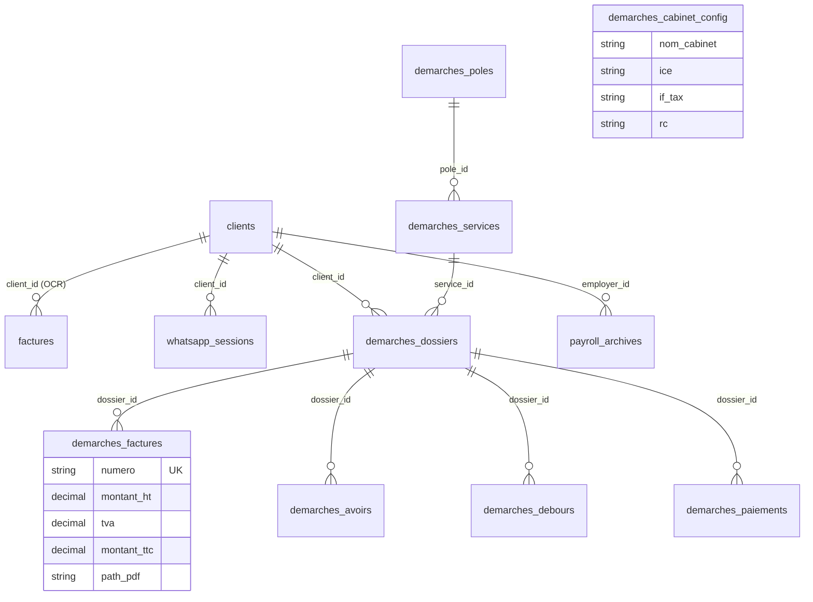

# 05 — Modèle de données et dépendances

> Phase 1 — lecture seule. **BE** = `smartcompta-v4/smartcompta-v6-backend/`, **FE** = `smartcompta-v4/smartcompta-v6-frontend/`.

## 1. Stockage

| Support | Usage prouvé | Source |
|---|---|---|
| MySQL (SQLAlchemy + PyMySQL) | Base principale (`DATABASE_URL`) | `BE/app/db/engine.py` |
| Base MySQL de télémétrie séparée (`IA_TELEMETRY_DB`, défaut `nextcloud_db`) | Table `ia_usage_log` | `BE/app/core/config.py` l.161-168, `BE/app/core/sidecars/*` |
| JSON sur disque `BE/data/` | Repli si MySQL indisponible : `invoices.json`, clients, `users.json`, `tokens.json` | `BE/app/db/service_factory.py`, `BE/app/services/{storage,client_service,auth}.py` |
| Fichier `BE/app/payroll_module/data/params.json` | Paramètres de paie | `params_store.py` |
| Disque `BE/uploads/` | Fichiers téléversés ; logo cabinet (`uploads/logos/`) ; **servi publiquement** sous `/uploads` | `BE/main.py` l.517 |
| Disque `BE/exports/` | PDF / XLSX générés, **purgés au démarrage après 7 jours** | `BE/main.py` l.242-248 |
| Nextcloud (WebDAV) | Espaces documentaires des clients du cabinet | `BE/app/services/nextcloud_service.py` |

Le moteur exact (MySQL vs MariaDB) et sa version sont `NON DOCUMENTÉ — À CONFIRMER` (voir 01 §3 C4). Le nom de la base varie selon les commentaires (`smartcomptav6_db`, `smartcomptav4_db`).

## 2. Tables (ORM)

### 2.1 Cœur (`BE/app/db/models.py`)

| Table | Clé | Colonnes notables | Relations |
|---|---|---|---|
| `factures` | `id` UUID | `type_document` (`facture`/`releve_bancaire`), `status` (`pending…validated`), `data_json` (DonneesFacture), `ecritures_json`, `is_validated`, `client_id`, `nextcloud_path` | FK `clients.id` SET NULL. **Documents importés / extraits par OCR**, pas des factures émises. |
| `clients` | `id` UUID | `name`, `email`, `nextcloud_user_id` (unique), `nextcloud_password` (clair), `nextcloud_provisioned`, `quota`, `default_document_type` (`achat`/`vente`), `type_client` (texte libre), `secteur_activite`, `rc_number`, `cin_number`, `whatsapp_unique_id`, `whatsapp_nextcloud_folder`, `employer_info` | Référencée par `factures`, `client_deadlines`, `compliance_entries`, `payroll_archives`, `whatsapp_sessions`, `demarches_dossiers`. **Pas d'adresse, ICE, IF, téléphone.** |
| `payroll_archives` | `id` int | `employer_id`, `employee_name`, période, `salary_data` JSON, `pdf_url`, `excel_url` | FK `clients.id` CASCADE ; unicité employeur/salarié/période. |
| `users` | `id` UUID | `username` unique, `password_hash`, `salt`, `role`, droits `can_upload/edit/validate/export/delete` | — |
| `tokens` | `token` | `user_id`, `role`, `expires_at` | FK `users.id` CASCADE. |
| `whatsapp_sessions` | `id` UUID | `phone_number` unique, `state`, `client_id`, `selected_menu`, `retry_count`, `last_user_message`, `last_bot_message`, `context_json`, `is_active`, horodatages | FK `clients.id` SET NULL. |
| `whatsapp_config` | `id` UUID | `is_enabled`, `evolution_api_url`, `evolution_api_key` (clair), `evolution_instance`, `nextcloud_base_folder`, `folder_map_json`, `request_timeout_seconds` | Ligne unique de fait (`first()`). |
| `legal_references`, `client_deadlines`, `compliance_entries` | UUID | Conformité (montants `Numeric(14,2)`, enums source / catégorie / statut) | FK `clients`, `demarches_services`, `legal_references`. |

### 2.2 Démarches (`BE/app/db/demarches_models.py`) — seul sous-domaine de facturation émise

| Table | Colonnes notables | Remarque pour la mission |
|---|---|---|
| `demarches_poles` | `nom` unique, `description`, `actif` | Regroupement de services. |
| `demarches_services` | `pole_id`, `nom`, `delai_jours`, `prix_base_ht` Numeric(12,2), `taux_tva` Numeric(5,2) défaut 20.00 | **Catalogue de prestations existant.** |
| `demarches_cabinet_config` | `nom_cabinet`, `adresse`, `ice`, `if_tax`, `rc`, `cnss`, `tel`, `email`, `site_web`, `logo_url` | **Identité de l'émetteur** (une ligne). |
| `demarches_dossiers` | `client_id` (FK clients, SET NULL), `client_nom`, `client_ice`, `service_id` (RESTRICT), `statut` (`en_attente`/`en_cours`/`cloture`), dates, `archived` | Un service par dossier. Le client facturé est **dénormalisé** (`client_nom`, `client_ice`). |
| `demarches_debours` | `dossier_id`, `description`, `montant` | Frais avancés, rendus « Exonéré » de TVA dans le PDF. |
| `demarches_paiements` | `dossier_id`, `date_paiement`, `type_paiement` (Espèce/Chèque/Virement/Effet), `montant` | — |
| `demarches_lignes_checklist` | `document_nom`, `statut`, `fichier_url` | — |
| `demarches_factures` | `dossier_id`, `numero` unique, `date_creation`, `montant_ht`, `tva` (taux), `montant_ttc`, `path_pdf` | **Facture émise** — pas de lignes, pas de statut, pas de client direct. |
| `demarches_avoirs` | `dossier_id`, `numero` unique, `montant_avoir`, `justification`, `path_pdf` | Généré seulement en cas de surpaiement net. |

Fichier mort probable : `BE/app/db/models/demarches.py` (version antérieure divergente, non importée — voir 01 §3 C7).

### 2.3 Diagramme (tables pertinentes pour la mission)

## 3. Gestion du schéma

| Mécanisme | Constat |
|---|---|
| `Base.metadata.create_all` | Au démarrage (`init_db`) et via `POST /api/settings/db/init` (sans authentification). Crée les tables manquantes, ne modifie pas les existantes. |
| `ALTER TABLE … ADD COLUMN IF NOT EXISTS` / `CREATE INDEX IF NOT EXISTS` | Exécutés à chaque démarrage (`engine.py` l.104-127). Compatibilité moteur à confirmer. |
| `*_schema_sync.py` | Ajouts ciblés de colonnes (paie, conformité, démarches). |
| `BE/sql_migrations/001-006` | Scripts manuels, numérotation séquentielle. |
| `POST /api/demarches/setup-db`, `/patch-db-tva` | Migrations déclenchées par API, sans authentification. |
| Alembic | Déclaré dans `requirements.txt`, **non utilisé** (aucun répertoire de migration). |

Pour le futur module, la convention la plus cohérente avec l'existant serait : modèles SQLAlchemy dans un nouveau fichier enregistré par `init_db()` + script `sql_migrations/007_*.sql` — **à valider**, aucune décision prise ici.

## 4. Calculs monétaires existants

| Lieu | Règle prouvée |
|---|---|
| `demarches/router.py` `generer_facture` l.875-885 | `prestation_ttc = (prix_base_ht × (1 + taux/100)).quantize(0.01)` ; `total_ttc = prestation_ttc + Σ débours` ; `montant_ht` stocké = prix du service seul (débours exclus). |
| `facturation_pdf.InvoicePDFGenerator.generate` | Recalcule HT / TVA / TTC à partir du service et des débours ; affiche « MAD » en dur. |
| `BE/app/utils/money.py` | `to_decimal` : quantize 0.01 `ROUND_HALF_UP`. Non utilisé par Démarches (mode d'arrondi différent possible, voir 03 §6). |
| `config.Settings.TVA_RATES` | 20 / 14 / 10 / 7 / 0 (commentaire « CGI 2025 »). Utilisé pour la validation OCR. Ces taux et règles ne doivent pas être repris sans validation (REQ-BIZ-01). |

## 5. Dépendances

### 5.1 Backend (`BE/requirements.txt`)

| Domaine | Paquets | Utilité pour la mission |
|---|---|---|
| Web | `fastapi==0.115.0`, `uvicorn[standard]`, `python-multipart`, `websockets==12.0` | Socle. |
| Validation | `pydantic==2.9.0`, `pydantic-settings` | Schémas. |
| Données | `SQLAlchemy>=2.0.25`, `pymysql`, `cryptography`, `alembic` (inutilisé) | Persistance. |
| PDF | `reportlab==4.1.0` (factures Démarches, conformité), `xhtml2pdf` + `jinja2` (bulletins de paie HTML→PDF), `PyMuPDF`, `Pillow` | **Génération de devis / factures possible sans nouvelle dépendance.** |
| Tableur / Word | `openpyxl`, `pandas`, `python-docx` | — |
| HTTP | `httpx==0.26.0` (déclaré) ; **`requests` utilisé mais non déclaré** (`evolution_api_service.py`, `nextcloud_service.py`, `settings_routes.py`) | Risque d'installation cassée si aucune dépendance transitive ne l'apporte — `NON DOCUMENTÉ — À CONFIRMER`. |
| IA | `anthropic`, `google-generativeai`, `google-cloud-documentai`, `google-api-python-client` | Hors périmètre. |
| Tests | `pytest`, `pytest-asyncio` | Disponibles. |

### 5.2 Frontend (`FE/package.json`)

`vue@^3.5.13`, `vue-router@^4.3.0`, `pinia@^2.1.7`, `axios@^1.6.7`, `lucide-vue-next`, `vuedraggable` ; dev : `vite@^6`, `vue-tsc`, `typescript~5.3`, `tailwindcss@^3.4`. Aucune librairie de formulaires, de tableaux ni de PDF côté client : le PDF est produit côté serveur.

### 5.3 Services externes

| Service | Usage | Configuration |
|---|---|---|
| Evolution API (WhatsApp) | Réception (webhook), envoi texte, téléchargement média, QR | Table `whatsapp_config` |
| Nextcloud | Comptes clients (OCS), fichiers (WebDAV) | `NEXTCLOUD_*` |
| Google Document AI, Gemini, Anthropic | Extraction | `GOOGLE_*`, `ANTHROPIC_API_KEY`, credentials JSON |
| Google Calendar | Échéances | `GOOGLE_CALENDAR_DELEGATED_SUBJECT`, credentials JSON |

## 6. Dépendances internes utiles au futur module

| Besoin | Composant existant | Fichier |
|---|---|---|
| Session BDD | `get_session` (dépendance FastAPI) | `BE/app/db/engine.py` l.64 |
| Authentification / rôles | `get_current_user`, `require_admin`, `require_permission` | `BE/app/api/auth_routes.py` l.68-110 |
| Identité émetteur | `DemarcheCabinetConfig` + `GET/PUT /api/demarches/config-facture` | `demarches_models.py`, `demarches/router.py` l.268-315 |
| Catalogue | `DemarcheService` + CRUD | `demarches/router.py` l.647-722 |
| PDF | `InvoicePDFGenerator` (logo, en-tête, tableaux, pied de page légal ICE/RC/IF/CNSS) | `BE/app/services/facturation_pdf.py` |
| URL de téléchargement | `settings.export_pdf_public_path` + `GET /api/exports/{filename}` | `config.py` l.227 ; `routes.py` l.432 |
| Sélection client (UI) | `ClientSearchSelect.vue`, `ClientCreateModal.vue` | `FE/src/components/clients/` |
| Notification temps réel | `ws_manager.broadcast` | `BE/main.py` |
| Messages WhatsApp | `evolution_api_service.send_text_message`, `whatsapp_state_machine_service` | voir 04 |

## 7. Collisions et risques de nommage

| Terme | Usage actuel | Risque |
|---|---|---|
| `factures` (table), `Facture` (Pydantic), `/api/invoices`, `invoiceStore`, menu « Factures » | Documents **importés** (OCR) | Confusion avec les factures **émises** du nouveau module. Un espace de noms distinct sera nécessaire. |
| `clients` | Dossiers du cabinet | Si le module facture les clients **des clients** (Q-01), il faudra une entité distincte. |
| `demarches_factures` | Factures émises du module Démarches | Doublon fonctionnel possible avec le nouveau module (Q-05 de 01). |
| `/api/clients` | Routeur legacy cassé | Ne pas réutiliser ce préfixe sans décision. |
